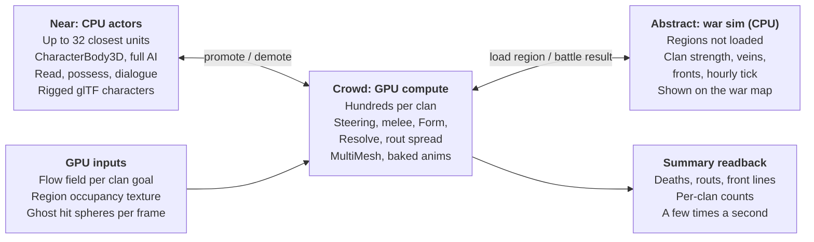

# Ghostopia: Underveil handoff

Nov 19, 2026 · Scott · Shared copy: [claude.ai doc](https://claude.ai/artifact/HHpBPD6861JnkYRw4YDAS9)

## Purpose

The next job is a battle prototype that proves hundreds of undead per clan can fight in Godot and that breaking a flank with one scare feels great. This doc hands the Underveil design and that brief to a fresh agent. Read it top to bottom, then read the full design in the repo before writing any code.

Scott (the director) owns design and feel decisions. Anything this doc leaves open goes back to him as a question, not a guess.

## Project context

Ghostopia is a cute-spooky third-person voxel survival game in Godot 4. You play a ghost in the Veil, an afterlife built from memories, and you grow by scaring the living. The Millbrook vertical slice (task1 to task5) is built and on `main` at [github.com/snsie/ghostopia](https://github.com/snsie/ghostopia).

| What | Where |
| --- | --- |
| Mechanics, the source of truth | `docs/design/design-plan.md`, section **The Underveil** |
| Art style block and prompts | `Ghostopia — concept art and tasks.md`, section **4.8 Underveil** |
| Project rules, tools, commands | `CLAUDE.md` at the repo root |
| Workflow | The **game-pipeline** skill: art from ChatGPT, Blender Python, Godot assembles from JSON |
| Existing caverns (the first descents) | `scripts/world/caverns.gd` |
| Player, attacks, BOO | `scripts/actors/player.gd` |
| Voxel world (192 × 48 × 192, 16³ chunks) | `scripts/voxel/voxel_world.gd` |
| Feel numbers | `assets/data/tuning.json` |

Tools on Scott's Windows machine: Godot 4.7.2 at `/c/Tools/Godot/` (`godot_console.exe` for headless), Blender 5.2, and Python 3.13. Use Bash (Git Bash), never PowerShell. Unit tests run with `tools/run-tests.sh`; the game self-tests with `--autotest` and `--tour`. Builds target Windows and macOS.

## The Underveil in brief

The Underveil is a vast underground afterlife where the forgotten dead live in clans and fight over **Memory Veins**, the last glowing seams of remembrance. Land the Hollow eats on the surface sinks there, so surface neglect feeds it.

- **Regions:** a handful of large regions, each its own voxel map loaded on descent, joined by tunnels and underground rivers. The three caverns under Millbrook (Fungal Grotto, Flooded Ossuary, Crystal Hollow) are the first descents.
- **Rhythm:** it is always shaded underground, so day is Underveil time and night is scaring time above.
- **Folklore still applies:** spirits can't cross running water, so rivers are clan borders and battles happen at fords and bridges.

| Clan | Stance | Who they are | Home region |
| --- | --- | --- | --- |
| Mycelial Kin | Friendly | Gentle dead with fungus growing through them; the Spore Keeper's people | Glowcap Warrens |
| Drowned Parish | At war | A congregation drowned in their flooded chapel; the only dead who can move through water | The Drowned Nave |
| Barrow Host | At war | Ancient chieftains and warbands from sunken burial mounds; can't cross rivers | The Barrow Halls |
| Bonewardens | Hostile | Skeletons who kept their bodies and despise ghosts for letting go | Ossuary Deep |
| Velvet Wake | Deceptive | An endless funeral party that drains its guests and sells secrets to both sides | The Candle Court |

The Parish and the Barrow Host fight over the **Sunken Ford**, the richest vein in the upper Underveil. The Crystal Hollow sentinels stay unaligned wildlife.

**Standing:** each clan rates you from Hated to Kin. Standing gates trade, recipes, quests, safe passage and recruits. The Velvet Wake shows a fake Standing until you expose it with the Read skill.

**How a ghost fights:** every undead has two bars, and emptying either takes it out.

| | Form (damage) | Resolve (fear) |
| --- | --- | --- |
| Lowered by | Tool swings, BOO's close burst, telekinetic throws, rockfalls | Clan fears, haunted war gear, possessed banner bearers and captains, big scares |
| At zero | Scattered: bursts into wisps and re-forms later at its clan's vein | Routed: flees home and lowers its neighbours' Resolve |
| Scale | One unit or a small group | Spreads through the whole crowd |

Hits also lower Resolve a little, and shaken units take extra damage. Fright still comes only from scares and breaks; scattering pays materials. Battles are graded Spooked, Terrified or Legendary, like scares.

**Battle sizes:** skirmishes of up to about 40, battles of 100 to 300 per side, and scripted Great Battles of about 1,000 across two or three clans.

**Wars without you:** a CPU simulation moves each clan's strength and fronts every in-game hour, shown on a journal war map. Clans with veins re-form their scattered dead; a clan with none fades.

**Rewards:** Fright, Underveil materials, clan relics, recruits who become named residents in your graveyard, and friendly-held veins that slow Hollow erosion on the surface above.

## Technical plan

Hundreds of undead per clan is too many for one Godot node each, so the battle runs in three tiers. Only the units closest to the ghost are full Godot actors; everyone else is a GPU crowd.

The CPU only ever reads a small summary back from the GPU, never the whole unit buffer every frame.

- **Compute shaders** run through Godot's `RenderingDevice` on the Forward+ renderer the project already uses: Vulkan on Windows, Metal on macOS. A Web build would need the CPU path and a much smaller army.
- **Flow fields** are baked once per clan goal on a coarse grid of the region, so pathfinding cost doesn't grow with unit count.
- **Resolve runs on the GPU:** each unit checks nearby routing units through the same spatial hash it uses for separation, which makes routs cascade for free.
- **Ghost hits:** single-target swings land on near actors. BOO bursts, throws, rockfalls and scares are written each frame as hit spheres that every crowd unit inside one feels.
- **Terrain:** the crowd reads a baked height and occupancy texture of the region, rebaked when blocks change.
- **Promotion:** a crowd unit swapped for a real actor, and back, carries its position, Form, Resolve and clan.
- **Headless tests:** Godot's headless mode has no `RenderingDevice`, so the crowd also has a CPU reference version with the same data layout. Tests and `--autotest` use it; `--battle-bench` runs the GPU version on real hardware.
- **Budget:** 60 fps at 1080p on a mid-range GPU with 1,000 crowd units and 32 near actors.
- **Pipeline fit:** Blender scripts make the clan characters, bake vertex-animation textures for the crowd, and write region layouts and clan populations as JSON.

## Decisions and open questions

Scott decided two things on Nov 19, 2026: ghosts can damage undead (Form) as well as break Resolve, and the Underveil is a handful of large linked regions rather than one streamed world. Everything else in the design is a proposal he hasn't signed off yet.

Still open for Scott:

- [ ] Does scattering undead pay Fright, or only materials (proposed)?
- [ ] Is Hollow-eaten land sinking into the Underveil the right origin story?
- [ ] Are the five clans and their names the right cast?
- [ ] Can the Bonewardens ever become friendly, and can the player end a clan entirely?
- [ ] Is day underground and night on the surface the right rhythm, or does the Underveil need its own clock?

None of these block the battle prototype. Build it with the proposed answers and log each assumption in `decisions.md`.

## Repo state

The Underveil design, the art prompts and this handoff were committed together with this file. Before that commit, `main` was at `6ddfb8e`.

- `docs/design/design-plan.md`: the new **The Underveil** section, a pointer to it in The world, a battle-fun gate in Development roadmap, and the Underveil open questions.
- `Ghostopia — concept art and tasks.md`: section **4.8 Underveil** with the mood add-on and prompts for six regions, the Underveil map and the clan lineups.

What the game can do today: underground caverns with one enemy each, and enemies that hurt the ghost. The ghost can swing tools and BOO, aimed along the camera reticle, but **nothing it does damages undead yet**. No Underveil concept art has been ordered.

## Next step: the battle prototype

Build the smallest battle that passes the **battle-fun gate** before any clan content: if breaking a flank with one well-timed scare doesn't feel great, the design changes first. Work on a branch, keep it separate from the Millbrook slice, and finish with Windows and macOS builds.

Scope:

1. **Arena:** one flat cavern region, about 128 × 128 blocks, with a river across the middle and one ford. Placeholder geometry is fine.
2. **Two clans of about 500 units each**, Parish against Barrow, as simple placeholder meshes with a baked walk and attack.
3. **GPU crowd** in a compute shader: flow-field movement toward the ford, separation, melee contact, Form and Resolve.
4. **Rout cascade:** a routing unit lowers nearby Resolve, so a broken flank visibly collapses.
5. **Ghost damage:** tool swings hit near actors; BOO and thrown objects reach crowd units through the hit-sphere buffer.
6. **Promotion and demotion** of the nearest 32 units into full actors and back, keeping their state.
7. **One clan fear to play with:** the Parish's bells. Silencing them drops that clan's Resolve.
8. **CPU reference version** of the crowd sim with the same data layout, for headless tests.
9. **`--battle-bench`** mode that runs the GPU version and logs frame times.

Acceptance:

- [ ] 60 fps at 1080p with 1,000 crowd units plus 32 near actors on Scott's Windows PC, logged by `--battle-bench`
- [ ] Runs on macOS (Metal) with frame times logged, even if lower
- [ ] Unit tests for the CPU sim pass in `tools/run-tests.sh`: movement, melee, Form, Resolve, rout spread, hit spheres
- [ ] `--autotest` covers entering the arena, a hit that scatters a unit, and a scare that routs a flank
- [ ] Screenshots of the battle before and after a rout, compared by eye
- [ ] `decisions.md`, `issues.md` and a report written, as every task does

Then stop and hand Scott the build to play. Don't start Underveil content, clans or art until he says the battles are fun.
